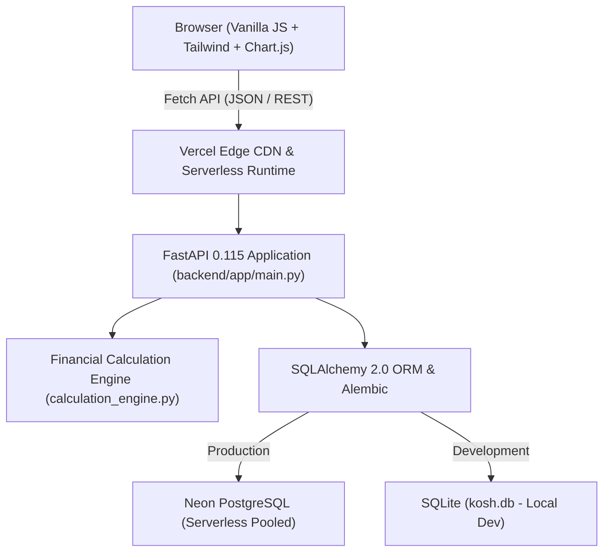

# 🛠️ Technical Stack & Architectural Overview

[[00_Home_Index|← Back to Vault Index]]

## 1. High-Level Architecture

Klyro is built with a clear separation of concerns between client presentation, business logic calculation, and cloud persistence:

---

## 2. Frontend Technology Stack

The frontend is intentionally designed with **zero build steps** (no Webpack, Vite, or Node bundling). It runs natively in modern browsers.

| Component | Technology | Purpose |
| :--- | :--- | :--- |
| **Language** | Modern JavaScript (ES2022+ Vanilla ES Modules) | Native modularity (`import`/`export`), lightweight, zero build overhead. |
| **Styling** | Tailwind CSS CDN + Custom Editorial Theme CSS | Tactile warm ivory palette, serif Fraunces typography, burnt coral accents. |
| **Data Visualization** | Chart.js 4.x (via jsDelivr CDN) | Interactive spending breakdown donuts, cash flow trendlines, budget pace bars. |
| **Delight & Feedback** | Canvas Confetti (v1.9.3) | Confetti explosions on logging transactions and hitting 100% goal milestones. |
| **Icons** | Custom Inline SVG System | Feather-weight vectors styled directly via Tailwind utility classes. |
| **Routing** | Vanilla Hash-Based Router (`#home`, `#transactions`, etc.) | Instant client-side view switching without triggering full-page server reloads. |
| **State Management** | Centralized Reactive Store (`frontend/js/store.js`) | Single source of truth for accounts, user profile, active dates, and caches. |

---

## 3. Backend Technology Stack

The backend is a high-performance Python ASGI web service focused on mathematical accuracy and explainability.

| Component | Technology | Version | Purpose |
| :--- | :--- | :--- | :--- |
| **Framework** | **FastAPI** | `>=0.115.0` | Asynchronous REST API, auto-generated OpenAPI 3.x docs (`/docs`), high speed. |
| **Data Validation** | **Pydantic v2** & **Pydantic-Settings** | `>=2.10.0` | Strict request/response schema parsing and type safety. |
| **ORM** | **SQLAlchemy** | `>=2.0.36` | Database abstraction layer with typed 2.0 select syntax and relationship management. |
| **Migrations** | **Alembic** | `>=1.14.0` | Declarative, versioned schema migrations tracking table evolutions. |
| **Auth & Security** | **PyJWT**, **Bcrypt**, **pwdlib** | Latest | Stateless JWT Bearer tokens and bcrypt salt hashing. |
| **Database Driver** | **psycopg[binary]** | `>=3.2.0` | Modern, high-performance PostgreSQL 3 driver supporting serverless connection pooling. |

---

## 4. Dual-Engine Persistence Strategy

1. **Local Development (Offline-First):**
   - Uses SQLite (`sqlite:///./kosh.db`).
   - Automatically executes `PRAGMA foreign_keys = ON;` upon connection to guarantee relational integrity.
2. **Production Hosting (Vercel Serverless):**
   - Connects to **Neon Serverless PostgreSQL** using pooled connection strings.
   - Automatically sets `pool_pre_ping=True` and `pool_recycle=300` to prevent stale connection drops across lambda cold starts.

---

[[02_Database_ER_and_Tables|Next: 02. Database ER Diagram & Table Schemas →]]
