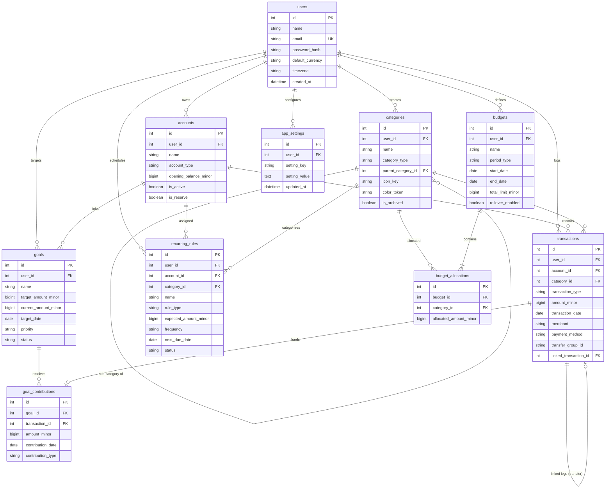

# 🗄️ Database ER Diagram & Table Schemas

[[01_Tech_Stack|← 01. Tech Stack]] | [[00_Home_Index|Index]] | [[03_API_Specification|03. API Specification →]]

## 1. Golden Rule: Integer Paise Arithmetic

> [!IMPORTANT]
> **No floats for money.**
> All monetary values in Klyro are modeled as **64-bit BigInteger paise** (minor units; ₹1.00 = 100 paise).
> This completely eliminates binary floating-point rounding errors (such as `0.1 + 0.2 = 0.30000000000000004`).

---

## 2. Entity-Relationship (ER) Diagram

---

## 3. Detailed Table Documentation

### 1. `users`
Stores user authentication credentials and profile preferences.
- `id` (INT, PK): Unique user identifier.
- `name` (VARCHAR(100)): Full name.
- `email` (VARCHAR(255), UNIQUE): Login email.
- `password_hash` (VARCHAR(255)): Bcrypt salted password hash.
- `default_currency` (VARCHAR(3), default `'INR'`): ISO-4217 currency.
- `timezone` (VARCHAR(50), default `'Asia/Kolkata'`): User timezone.
- `created_at` / `updated_at` (DATETIME): Timestamps.

### 2. `accounts`
Represents physical or digital financial accounts (Bank, Wallet, Cash, Credit Card, Investment).
- `id` (INT, PK): Unique account ID.
- `user_id` (INT, FK -> `users.id`): Owner.
- `name` (VARCHAR(100)): Name (e.g. "HDFC Salary Bank").
- `account_type` (VARCHAR(30)): `'bank'`, `'wallet'`, `'cash'`, `'credit_card'`, `'investment'`.
- `opening_balance_minor` (BIGINT): Starting balance in paise.
- `institution_name` (VARCHAR(100), optional): Bank/provider name.
- `is_active` (BOOLEAN, default `True`): Soft deletion flag.
- `is_reserve` (BOOLEAN, default `False`): **Emergency reserve flag**. When `True`, funds in this account are treated as locked emergency reserves and excluded from spendable liquid funds.

### 3. `categories`
Hierarchical spending and earning taxonomies.
- `id` (INT, PK): Unique category ID.
- `user_id` (INT, FK -> `users.id`, nullable for system defaults).
- `name` (VARCHAR(100)): e.g. "Dining & Food", "Housing & Rent".
- `category_type` (VARCHAR(20)): `'expense'`, `'income'`, `'transfer'`.
- `parent_category_id` (INT, FK -> `categories.id`, nullable): Enables nested sub-categories.
- `icon_key` (VARCHAR(50)): Lucide/custom icon identifier.
- `color_token` (VARCHAR(50)): Visual badge color token.
- `is_archived` (BOOLEAN, default `False`).

### 4. `transactions`
The immutable financial ledger recording every rupee movement.
- `id` (INT, PK): Ledger entry ID.
- `user_id` (INT, FK -> `users.id`).
- `account_id` (INT, FK -> `accounts.id`): Impacted account.
- `category_id` (INT, FK -> `categories.id`, optional): Assigned category.
- `transaction_type` (VARCHAR(20)): `'expense'`, `'income'`, `'transfer'`.
- `amount_minor` (BIGINT): Value in paise.
- `merchant` (VARCHAR(150), optional): Vendor or counterparty.
- `transaction_date` (DATE): Date of execution.
- `payment_method` (VARCHAR(30)): `'upi'`, `'credit_card'`, `'debit_card'`, `'net_banking'`, `'cash'`.
- `transfer_group_id` (VARCHAR(64), optional): UUID binding two ledger rows for atomic transfers.
- `linked_transaction_id` (INT, FK -> `transactions.id`, optional): Cross-references the sister leg.
- `recurring_rule_id` (INT, FK -> `recurring_rules.id`, optional): Identifies auto-generated commitment entries.

### 5. `budgets` & 6. `budget_allocations`
Defines monthly or custom period expenditure envelopes.
- `budgets.id` (INT, PK)
- `budgets.period_type` (VARCHAR(20)): `'monthly'`, `'quarterly'`, `'annual'`.
- `budgets.start_date` / `end_date` (DATE).
- `budgets.total_limit_minor` (BIGINT, optional): Aggregate limit cap.
- `budget_allocations`: Category-level limits (`allocated_amount_minor` in paise) mapped to `budget_id` + `category_id` with a UNIQUE compound constraint.

### 7. `recurring_rules`
30-day forward-looking radar entries for predictable cash flow.
- `rule_type`: `'salary'`, `'rent'`, `'sip'`, `'emi'`, `'subscription'`, `'utility'`.
- `frequency`: `'monthly'`, `'weekly'`, `'annual'`, `'custom'`.
- `next_due_date` (DATE): Next calendar debit/credit date.
- `expected_amount_minor` (BIGINT): Expected amount in paise.

### 8. `goals` & 9. `goal_contributions`
Milestone-driven savings targets.
- `target_amount_minor` (BIGINT): Total goal target in paise.
- `current_amount_minor` (BIGINT): Progress in paise.
- `target_date` (DATE): Target completion milestone.
- `goal_contributions`: Records incremental savings deposits linked to either manual contributions or actual ledger transactions.

### 10. `app_settings`
Key-value user settings store for configurable preferences (cushion buffer %, theme mode, currency format).

---

[[03_API_Specification|Next: 03. API Specification & HTTP Methods →]]
