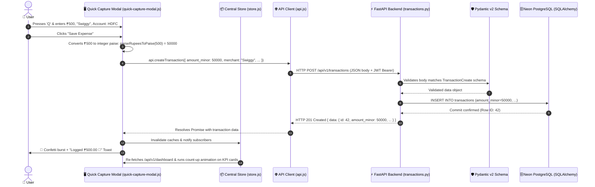

# 🌊 Client-to-Server Data Movement Lifecycle

[[03_API_Specification|← 03. API Specification]] | [[00_Home_Index|Index]] | [[05_Dashboards_and_Views|05. Dashboards & Views →]]

## 1. End-to-End Walkthrough: Logging a ₹500 Swiggy Expense

This note traces the **exact lifecycle of data** as it travels from the user's keystroke in the browser all the way to PostgreSQL in the cloud and back to animate the UI:



---

## 2. Step-by-Step Breakdown

### Step 1: User Action in Browser (Client Layer)
- The user hits the keyboard shortcut <kbd>Q</kbd> anywhere in the app.
- [`quick-capture-modal.js`](file:///c:/Users/Sanskriti%20Vadher/OneDrive/Desktop/HSB/T2/kosh-budget/frontend/js/components/quick-capture-modal.js) transitions into view with a smooth CSS scale spring.
- The user inputs `500` in the Amount box, selects Category "Dining", and clicks **Record Expense**.

### Step 2: Client-side Sanitization & Currency Conversion
- Money is never sent as a floating decimal.
- [`formatters.js`](file:///c:/Users/Sanskriti%20Vadher/OneDrive/Desktop/HSB/T2/kosh-budget/frontend/js/utils/formatters.js) runs:
  ```javascript
  const amountMinor = parseRupeesToPaise(500); // Result: 50000 (integer paise)
  ```

### Step 3: API Request Dispatch
- [`api.js`](file:///c:/Users/Sanskriti%20Vadher/OneDrive/Desktop/HSB/T2/kosh-budget/frontend/js/api.js) dispatches an asynchronous `fetch()` call:
  ```javascript
  fetch('/api/v1/transactions', {
    method: 'POST',
    headers: {
      'Content-Type': 'application/json',
      'Authorization': 'Bearer ' + authToken
    },
    body: JSON.stringify({
      account_id: 1,
      category_id: 3,
      transaction_type: 'expense',
      amount_minor: 50000,
      merchant: 'Swiggy',
      transaction_date: '2026-10-15',
      payment_method: 'upi'
    })
  });
  ```

### Step 4: FastAPI Router & Pydantic Validation (Backend Layer)
- FastAPI routes the incoming request to `create_transaction()` in [`backend/app/api/v1/transactions.py`](file:///c:/Users/Sanskriti%20Vadher/OneDrive/Desktop/HSB/T2/kosh-budget/backend/app/api/v1/transactions.py).
- Pydantic's `TransactionCreate` schema checks:
  1. `amount_minor > 0` (Rejects negative amounts with HTTP 422).
  2. `transaction_type in ['expense', 'income', 'transfer']`.
  3. `account_id` references an existing active account.

### Step 5: Database Persistence & Atomic Ledger Commit
- SQLAlchemy inserts the row into table `transactions`.
- In a transfer, SQLAlchemy atomically inserts **both legs** inside a single database transaction, ensuring that money can never be deducted from one account without appearing in the other.
- The transaction commits to Neon PostgreSQL.

### Step 6: Response & UI Reactive Refresh
- Backend returns `HTTP 201 Created` with the JSON envelope:
  ```json
  {
    "data": {
      "id": 42,
      "amount_minor": 50000,
      "merchant": "Swiggy",
      "transaction_type": "expense",
      "transaction_date": "2026-10-15"
    }
  }
  ```
- The frontend:
  1. Closes the modal.
  2. Fires a celebratory **Canvas Confetti** burst (coral & gold).
  3. Displays a rich toast: `"Logged ₹500.00 🎉"`.
  4. Triggers re-fetching of `/api/v1/dashboard`.
  5. The Safe-to-Spend ring and KPI counter animate and recalculate to reflect the new lower discretionary balance in real-time.

---

[[05_Dashboards_and_Views|Next: 05. The 8 Application Views & Dashboards →]]
