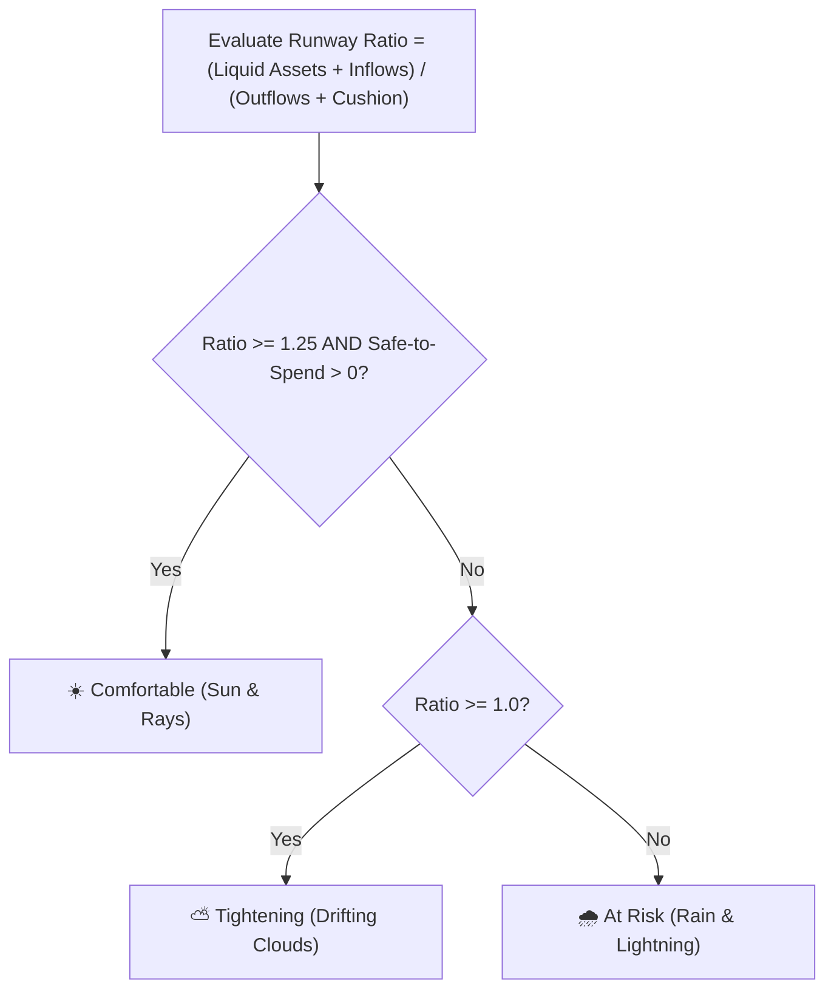

# 🧮 Financial Intelligence & Calculation Engine

[[05_Dashboards_and_Views|← 05. Dashboards & Views]] | [[00_Home_Index|Index]]

The heart of Klyro is its **Financial Calculation Engine** (`backend/app/services/calculation_engine.py`). It replaces guesswork with exact arithmetic.

---

## 1. Safe-to-Spend Formula

Safe-to-Spend is a mathematically sound answer to: *"How much money can I spend today without risking rent, bills, or savings before my next paycheck?"*

$$\text{Safe-to-Spend} = \max\left(0, \; \text{Liquid Spendable Funds} + \text{Expected Inflows} - \text{Mandatory Outflows} - \text{Safety Buffer}\right)$$

### Definitions:
1. **Liquid Spendable Funds:**
   - Sum of all Bank, Wallet, and Cash account balances **WHERE `is_reserve = False`**.
   - Accounts flagged as `is_reserve = True` (such as Emergency Funds) are strictly excluded so you never deplete your safety net.
2. **Expected Inflows:**
   - Scheduled salary credits or verified receivables due before the end of the calculation horizon.
3. **Mandatory Outflows:**
   - All upcoming recurring commitments (SIPs, EMIs, rent, utility bills, subscriptions) due before the next expected income.
4. **Safety Buffer (Cushion Reserve):**
   - A configurable percentage (default 10%) reserved to protect against lifestyle inflation or unplanned incidental expenses.
5. **Zero Clamping:**
   - Evaluated using $\max(0, \dots)$ so it never produces a deceptive negative discretionary spend number.

---

## 2. Daily Allowance Run-Rate

The daily spending limit shown in the center of the Safe-to-Spend ring is computed as:

$$\text{Daily Allowance} = \frac{\text{Safe-to-Spend}}{\text{Days Remaining Until Next Income}}$$

---

## 3. Money Weather Status Logic

Money Weather evaluates your forward-looking financial runway to determine one of three states:

| Weather State | Visual Icon | Criteria | Meaning |
| :--- | :--- | :--- | :--- |
| **Comfortable** | Spinning golden sun with rays | Liquidity safely exceeds commitments by $\ge 25\%$ | Discretionary funds available; savings targets are secure. |
| **Tightening** | Floating gray clouds | Liquidity covers bills, but leaves minimal discretionary headroom | Stick to essentials until next salary credit. |
| **At Risk** | Gentle rain + subtle lightning flicker | Outflows exceed available liquid funds ($\text{Ratio} < 1.0$) | Action required: defer non-critical spends or reallocate funds. |

---

## 4. Net Savings Rate Calculation

$$\text{Net Savings Rate} = \frac{\text{Inflows} - \text{Outflows}}{\text{Inflows}} \times 100\%$$

### Status Badges:
- **$\ge 30\%$:** 🌟 Excellent
- **$20\% - 29\%$:** 🌿 Healthy
- **$10\% - 19\%$:** ⚖️ Moderate
- **$< 10\%$:** ⚠️ Low

---

## 5. Atomic Two-Legged Transfer Ledger Mechanics

Moving ₹10,000 from `HDFC Salary` to `Zerodha Investment` creates **two linked ledger rows**:

| Leg | Account | Type | Amount | Transfer Group ID | Linked ID |
| :--- | :--- | :--- | :--- | :--- | :--- |
| Leg A (Outflow) | HDFC Salary Bank | `transfer` | `-1000000` paise | `uuid-7f8a...` | `ID_B` |
| Leg B (Inflow) | Zerodha Trading | `transfer` | `+1000000` paise | `uuid-7f8a...` | `ID_A` |

### Why this is mathematically critical:
1. **Zero Net Cash Flow Distortion:** Because both legs are marked as `transfer`, they are excluded from Income and Expense totals. Transferring money between your own accounts does not make you look richer or poorer.
2. **Reversibility:** Deleting one leg automatically rolls back the sister leg in a single atomic database operation.

---

[[00_Home_Index|← Back to Vault Index]]
