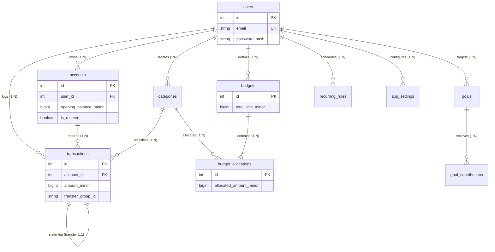
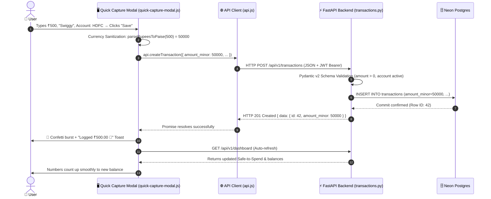

# 🎤 7–8 Minute Technical Presentation Slide Deck: Klyro Architecture

---

## Slide 1: Title & Architectural Thesis (30 Seconds)
### Header: **Klyro — Personal Financial Intelligence Workspace**
### Subheader: *Full-Stack Architecture, Banking-Grade Arithmetic & Serverless Deployment*

- **Live URL:** `https://klyro-iota.vercel.app/`
- **Product Thesis:** A personal financial intelligence workspace that combines deep financial reasoning (Money Weather, Safe-to-Spend) with zero-build frontend performance.
- **Key Engineering Pillars:**
  - **Zero Floating-Point Drift:** 100% integer paise arithmetic using 64-bit `BIGINT`.
  - **Decoupled Architecture:** Vanilla ES Modules + Tailwind CDN frontend with a Python FastAPI REST engine.
  - **Dual-Engine Persistence:** SQLite local development (`kosh.db`) seamlessly upgraded to Neon Serverless PostgreSQL in production.

---

## Slide 2: The Full-Stack Technical Stack (60 Seconds)
### Header: **Modern Decoupled Technical Stack**

```text
┌────────────────────────────────────────────────────────┐
│               CLIENT LAYER (Browser)                   │
│  Vanilla ES Modules (ES2022+) • Tailwind CSS CDN       │
│  Chart.js Data Visualizations • Canvas Confetti Delight│
└──────────────────────────┬─────────────────────────────┘
                           │ HTTP REST (JSON / JWT)
                           ▼
┌────────────────────────────────────────────────────────┐
│               API & LOGIC LAYER (FastAPI)              │
│  FastAPI 0.115 • Pydantic v2 Strict Schema Validation  │
│  Financial Calculation Engine • Atomic Transfer System │
└──────────────────────────┬─────────────────────────────┘
                           │ SQLAlchemy 2.0 ORM + Alembic
                           ▼
┌────────────────────────────────────────────────────────┐
│               PERSISTENCE LAYER                        │
│  Production: Neon PostgreSQL (Serverless Pooled)       │
│  Local Dev: SQLite (PRAGMA foreign_keys = ON)          │
└────────────────────────────────────────────────────────┘
```

- **Frontend Rationale:** Zero build tools (no Webpack, Vite, or npm bundle step) = instant browser load times and zero dependency bloat.
- **Backend Rationale:** FastAPI provides native ASGI async throughput and auto-generated OpenAPI 3.x schema docs.
- **Validation:** Pydantic v2 validates types, regexes, and positive numbers before SQL queries run.

---

## Slide 3: Database Entity-Relationship (ER) Diagram (60 Seconds)
### Header: **Database Architecture & ER Schema**



- **The Golden Rule:** Every monetary amount is stored as **Paise** (`amount_minor` in `BIGINT`). ₹500.00 = `50000`.
- **Atomic Two-Legged Transfers:** Moving money generates two rows sharing a UUID `transfer_group_id` with opposing +/- signs.
- **Emergency Reserve Protection:** Column `accounts.is_reserve = True` marks emergency funds, programmatically excluding them from spendable liquid assets.

---

## Slide 4: Table Structures & Schema Deep-Dive (60 Seconds)
### Header: **Detailed Database Schema (10 Core Tables)**

| Table Name | Primary Key | Foreign Keys | Key Columns & Data Types | Architectural Purpose |
| :--- | :---: | :--- | :--- | :--- |
| **`users`** | `id` | None | `email` (VARCHAR), `password_hash` (VARCHAR) | Bcrypt auth and profile preferences |
| **`accounts`** | `id` | `user_id` | `opening_balance_minor` (BIGINT), `is_reserve` (BOOL) | Separates liquid cash from locked reserves |
| **`categories`** | `id` | `user_id`, `parent_id` | `category_type` (VARCHAR), `icon_key`, `color_token` | Hierarchical spending/earning taxonomy |
| **`transactions`**| `id` | `user_id`, `account_id`, `category_id` | `amount_minor` (BIGINT), `transfer_group_id` (UUID) | Immutable double-entry cash flow ledger |
| **`budgets`** | `id` | `user_id` | `start_date`, `end_date`, `total_limit_minor` (BIGINT) | Time-bounded spending envelopes |
| **`budget_allocations`** | `id` | `budget_id`, `category_id` | `allocated_amount_minor` (BIGINT) | Category-specific spending limits |
| **`recurring_rules`** | `id` | `user_id`, `account_id` | `expected_amount_minor` (BIGINT), `next_due_date` | 30-day forward-looking bill radar |
| **`goals`** | `id` | `user_id`, `linked_account_id` | `target_amount_minor`, `current_amount_minor` | Milestones & savings velocity |
| **`goal_contributions`** | `id` | `goal_id`, `transaction_id` | `amount_minor` (BIGINT), `contribution_date` | Goal deposits & milestone ledger |
| **`app_settings`** | `id` | `user_id` | `setting_key` (VARCHAR), `setting_value` (TEXT) | Safety buffer cushion % & configuration |

- **Type Affinity in SQLite:** SQLite maps `VARCHAR` to `TEXT`, `BOOLEAN` to `INTEGER` (`0`/`1`), and `BIGINT` to 64-bit `INTEGER`, ensuring 100% parity with PostgreSQL.

---

## Slide 5: Complete API Specification (60 Seconds)
### Header: **RESTful API Specification (42 Endpoints)**

### What is an API?
An API is the digital messenger between the user interface and the server: the client asks for data or actions, the API validates the request, executes the calculation, and returns a structured JSON payload.

### Method Distribution Breakdown:
```text
  GET    : 21 Endpoints (Read & Query: Dashboards, Reports, Lists, Exports)
  POST   : 12 Endpoints (Create & Execute: Transactions, Transfers, Auth, Reseed)
  PATCH  :  4 Endpoints (Partial Updates: Accounts, Categories, Transactions, Rules)
  DELETE :  4 Endpoints (Permanent Deletions: Transactions, Categories, Budgets, Rules)
  PUT    :  1 Endpoint  (Full Resource Replacement: User Settings)
  TOTAL  : 42 Validated Endpoints
```

### Key Endpoint Highlights:
- **`GET /api/v1/dashboard/money-weather`:** Computes liquidity runway to return `Comfortable` / `Tightening` / `At Risk`.
- **`POST /api/v1/transactions/transfers`:** Atomically creates debit and credit legs; rejects identical source/destination accounts with `400 IDENTICAL_ACCOUNTS`.
- **`GET /api/v1/budgets/{id}/performance`:** Real-time run rate and pacing marker calculation.
- **`GET /api/v1/export/transactions`:** In-memory CSV stream generation without writing temporary files to disk.

---

## Slide 6: Client-to-Server Data Movement Lifecycle (60 Seconds)
### Header: **How Data Moves: Logging a ₹500 Expense**



- **Execution Guarantee:** Data is validated at the client boundary, re-validated strictly at the API layer, and committed transactionally to disk.

---

## 7. The 8 Application Dashboards (60 Seconds)
### Header: **Multiple Dashboards & Financial Calculations**

1. **⛅ Home Dashboard (`home.js`):** Executive cockpit with dynamic Money Weather hero illustration, circular Safe-to-Spend ring, and 4 KPI count-up cards.
2. **🧾 Transactions View (`transactions.js`):** Multi-filter ledger (categories, accounts, dates, payment methods) with atomic transfer chain badges.
3. **🏦 Accounts View (`accounts.js`):** Asset breakdown isolating **Liquid Funds** from **Locked Emergency Reserves**.
4. **💓 Budgets View (`budgets.js`):** Category pulse bars with real-time **"where you should be today"** pacing cursors.
5. **🎯 Goals View (`goals.js`):** Milestone savings velocity forecasting completion dates based on 3-month rolling averages.
6. **📅 Recurring View (`recurring.js`):** 30-day commitments radar tracking EMIs, SIPs, and rent auto-debits with relative urgency tags.
7. **🧬 Insights View (`insights.js`):** Spending DNA behavioral analysis and Chart.js category donuts.
8. **⚙️ Settings View (`settings.js`):** Safety buffer slider (5%–20%), in-memory CSV/JSON exports, and demo re-seed.

### Mathematical Foundations:
$$\text{Safe-to-Spend} = \max\left(0, \; \text{Liquid Funds} + \text{Inflows} - \text{Outflows} - \text{Buffer Cushion}\right)$$
$$\text{Daily Allowance} = \frac{\text{Safe-to-Spend}}{\text{Days Remaining in Cycle}}$$

---

## Slide 8: Production Hosting on Vercel & Neon PostgreSQL (45 Seconds)
### Header: **Cloud Deployment & Serverless Architecture**

- **Live URL:** `https://klyro-iota.vercel.app/`
- **Hosting Platform:** **Vercel** via native FastAPI framework integration (`pyproject.toml` pointing to `backend.app.main:app`).
- **Production Database:** **Neon PostgreSQL Serverless** (pooled connection string via `psycopg3`).
- **Serverless Resilience Patterns:**
  - **Connection Pooling:** Uses Neon connection pooler with `pool_pre_ping=True` and `pool_recycle=300`.
  - **Stateless Runtime:** In-memory CSV and JSON streaming exports — zero disk writes on ephemeral serverless filesystems.
  - **Zero Cold Start Crashes:** Lazy database engine instantiation and flexible environment variable parsing (`CORS_ORIGINS`).

---

## Slide 9: Conclusion & Engineering Takeaways (30 Seconds)
### Header: **Summary & Technical Highlights**

- **Deterministic Precision:** Zero floating-point rounding errors across all calculations via integer paise.
- **Clean Architecture:** Strict separation between presentation, calculation engine, API validation, and persistence.
- **Comprehensive API:** 42 rigorously tested endpoints with unified error envelopes and JWT security.
- **Portability:** Dual-engine persistence allows developers to work 100% offline with SQLite and deploy instantly to serverless Postgres in production.

---
*Thank you! Questions?*
